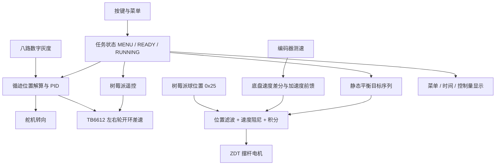

# 2026h 最新应用分析与复用依据

**归档说明**: 本文记录 2026-10-14 对 ti_cup 固定分支的分析。
2026-10-15 复制至本工程保留历史依据，旧 SDK、绝对路径和命令
不代表当前工程配置；当前开发范围以 pvc_control_plan.md 为准。
Debug 内归档构建/迁移脚本不应作为当前工程的日常构建入口。

**日期**: 2026-10-14。

**主要参考**: 用户确认 2026h 为最新比赛应用。
本次分析提交 23d6e82，保持工作区 main，不切换、不修改比赛源码。

**结论**: 后续类似工程应优先参考 2026h 的应用流程和模块组合，
使用 main 当前的驱动修复作为可靠性补充。
两者的 PID、灰度极性和外设配置不同，不能直接整层覆盖。

## 1. 实际系统组成

该分支实现 26H 车载平衡滚球系统，最新 README 仍是旧物流搬运说明。
有效入口是 main.c、board.c、tracking.c、balance.c 和 empty.syscfg。
questions/26h 的赛题 Markdown 可用于核对目标，但其中开发指引与
balance 控制说明也有旧 API、旧控制符号及并未实施的限幅描述。



注意：Pi 收帧回调直接调用 Balance_Update，没有检查 RUNNING 或任务类型。
图中的任务选择关系并未成为所有执行器输出的统一使能门控。

## 2. 初始化与调度

main 只调用一次 SYSCFG_DL_init，再执行 Board_Init 和 Tracking_Init。
2026h 的 Board_Init 已没有 main 基线的重复硬件初始化问题。

Board_Init 的实际顺序：PIT → TB6612 → Servo → Motor → Balance
→ Grayscale → Key → OLED → Pi UART。
Balance_Init 会等待上电、配置 ZDT、硬停回零、抬杆及重新标零，
默认配置等待总量约 6.3 秒，再加 OLED 的初始化与显示时间。
回零依赖固定延时，没有读取完成状态后再标零的闭环确认。

| 执行位置 | 内容 | 实际周期或触发 |
|---|---|---|
| TIMG12 ISR | 毫秒计数 | 1 ms |
| TIMG0 ISR | Motor 测速、Key 扫描 | 20 ms |
| Motor 速度发布 | 3 tick 窗口 + EMA | 60 ms |
| 主循环 Protocol_Update | 解析 Pi 帧并同步回调 | 每圈，可能一次处理多帧 |
| 循迹 PID/舵机 | Tracking_Update 内时间判断 | 至少相隔 10 ms，不是硬周期 |
| 轮速命令、速度斜坡、停车防抖 | Tracking_Update | 每次调用 |
| 平衡控制 | OnPiFrame → Balance_Update | 有效球位置帧到达时，设计约 50 Hz |
| 前馈计算 | ChassisFF_Update | 至少相隔 20 ms |
| OLED 运行显示 | Oled_Refresh | 100 ms，阻塞传输 |

OLED 刷新位于本圈任务更新之前。清屏约千次 I2C 事务；
它不会阻止 PIT ISR，但会延迟循迹、球位置消费和遥控看门狗检查。
这些控制量不是全部由 10/20 ms 定时中断保证更新。

## 3. 各任务如何使用模块

| 任务 | 入口与参数 | 实际行为 |
|---|---|---|
| 2：纯循迹一圈 | Tracking_Start，800 mm/s，diff_gain=7.8 | 转向 PID、差速、停车横线检测 |
| 3：静态平衡 | Balance_Start / Balance_SeqUpdate | +50 mm、-50 mm 两步，各到达后停留 1500 ms |
| 4：AB 循迹和平衡 | 600 mm/s、diff_gain=7.3，target=0 | 首次舵机输出超过弯道阈值 25 时停车 |
| 5：一圈与中心平衡 | 600 mm/s，target=0 | 循迹 + 视觉反馈 + 加速度前馈 |
| 6：任意点平衡 | 捕获首个 confidence>0 的球位置 | 以捕获位置为目标，其余与任务 5 类似 |
| 7：遥控 | Remote_Update | speed±diff 换算左右轮速度，500 ms 超时刹车 |

KEY3 选任务、KEY4 确认、KEY1 启动、KEY2 停止。
当前按键逻辑事件在消抖释放后产生，不是物理按下瞬间。
任务启动时通知 Pi；任务停止时上报 uint16 耗时，超过 65535 ms 会截断。

静态任务代码没有在主循环检查 Balance_IsDone。
序列结束后将目标改为 0，而赛题要求最终稳定在 -50 mm 附近。
任务 4 用转向阈值作为到达弯道的代理，实际 B 点判定仍需赛道验证。
横线检测也没有明确的“先离开起点 A，再允许停车”阶段。

## 4. 控制契约：应保留的经验

### 循迹

Grayscale_ReadAll 在 2026h 返回原始 mask：1=白，0=黑。
Tracking_CalcPosition 内部取反，计算加权中心并归一化到 [-1,1]；
全白返回 99，丢线时舵机缓慢回中，轮子仍继续驱动。
参数集中在 chassis_config.h，任务速度和差速增益可以分别调整。

控制方向通过 PID_Compute(..., -position) 建立。
舵机输出按每次最多 4 单位变化限制；在 10 ms 理想周期下为 400 单位/s。
差速量 = 舵机逻辑输出 * diff_gain，左右轮为 base_speed±diff。
这仍是开环轮速映射，编码器未用于维持实际轮速。

2026h PID 的计算为绝对 P + 受限累计 I + 误差二阶差分 D，
既不是标准位置式的一阶差分 D，也不是 main 的完整增量式。
当前循迹 Kd=0，该 D 差异未参与当前循迹输出。
直接换成 main PID 后，输出饱和及恢复过程会变化，必须重新验证调参。

### 球平衡

有效球位置以 mm 输入，先位置 EMA，再位置差分估速及速度 EMA。
传入的 ball_vel_mm_s 参数未使用，实际由模块估速。

```text
e = target_mm - filtered_position_mm
P = clamp(Kp * e, ±p_limit)
D = clamp(Kd * filtered_velocity_mm_s * deadband_fade, ±d_limit)
I = clamp(I + Ki * e * dt, ±i_limit)  [满足 PD 条件时积分]
angle = (P - D + I + pending_feedforward) * control_sign
```

低置信帧把位置误差减半，实际同时影响 P 和 I。
confidence=0 时冻结更新，没有在静态任务中独立处理完全断流。
角度通过软件跟踪上次指令，换算相对脉冲后发 ZDT QPos。
驱动器负责内部电机位置控制；MCU 没有读回确认摆杆实际位置。

### 底盘前馈

左右轮滤波速度平均 → 按实际调用 dt 差分 → mm/s² 转 m/s²
→ 非对称低通 → 乘 °/(m/s²) 增益 → 叠加到球平衡输出。
这是值得保留的思路，但测速数据每 60 ms 更新，前馈每约 20 ms 差分，
会出现两次零差分及一次集中跳变，需按测速新样本时刻计算。

## 5. 当前有效的外设与协议

| 资源 | 2026h 配置 | 与 main 的差别 |
|---|---|---|
| ZDT 电机串口 | UART0，TX=PA10、RX=PA11，115200 | main 此路名为 PRINT |
| Pi 串口 | UART3，TX=PA26、RX=PA25，115200 | main 为 UART1，PB6/PA9 |
| 蓝牙串口 | UART1，TX=PB6、RX=PB7，115200 | 仅 SysConfig 配置，未软件注册或接入遥控 |
| 电机与编码器 | TIMA0 PWM、GPIOA 编码器 | 引脚基本沿用公共基线 |
| 舵机 | TIMA1 PB2，5 MHz / 20000 | 仍为 4 ms 周期，需核对器件规格 |
| IMU | SPI/BMI088 仍配置 | 当前应用没有调用 IMU_Init/Update |
| 超声波 / TM1637 | 从配置及编译中排除 | 不属于当前 2026h 活跃功能 |

COBS + XOR 的有效命令在 main.c 中定义，不是旧 protocol_commands.h。

| 方向 | 命令 | 载荷 |
|---|---|---|
| Pi → MCU | 0x25 球位置 | int16 大端位置 mm + uint8 confidence |
| Pi → MCU | 0x26 在线调参 | uint8 param_id + float32 小端 |
| MCU → Pi | 0x27 参数 ACK | param_id + 读回 float32 小端 |
| Pi → MCU | 0x30 电机遥控 | int8 speed、int8 diff |
| Pi → MCU | 0x31 摆杆遥控 | int8 angle，注释约定 ±10°，代码未验证范围 |
| Pi → MCU | 0x32 停止 | 无载荷 |
| Pi → MCU | 0x2f 恢复循迹 | 无载荷 |
| MCU → Pi | 0x33 任务开始 | uint8 task_id，0～5 对应要求 2～7 |
| MCU → Pi | 0x34 任务停止 | uint16 大端 time_ms |

球位置来源需要遵守位置正方向、mm 单位和 confidence=0/1/2 的约定。
在线参数使用明确的小端 float，不能与大端位置整数混用。
旧 protocol_commands.h 混有物流搬运命令，且重复定义 CMD_STOP，
当前 main 未引用它，不应作为这一应用的协议真相源。

## 6. 已确认的问题及优先顺序

### 已用实际源码在主机复现的行为

使用未修改的 balance.c、tracking.c 和该分支 pid.c，
只把时间与执行器通信替换为 mock，未运行回零初始化或连接硬件。

| 优先级 | 问题 | 主机观察 |
|---|---|---|
| 高 | Balance 输出路径没有总角度限幅 | MAX_ANGLE=5，设 Kp=1/位置滤波=1，100 mm 误差产生 100° 指令 |
| 高 | Balance_Stop 未阻止后续位置更新输出 | Stop 后新球位置再次发出运动命令 |
| 高 | 前馈累加依赖两路调用频率 | 三次相同 1 m/s² 样本在下次平衡更新产生 22.5°，不是 7.5° |
| 中 | 斜坡在 dt=0 时直接赋目标速度 | 同一 tick 启动/更新，开启 ramp 仍跳到 600 mm/s |
| 中 | 停车防抖没有时间间隔 | 同一时间戳下三次横线轮询即可停车 |
| 中 | 静态序列最终目标与赛题不符 | +50/-50 完成后目标变为 0 mm |

这些测试确认现存问题，不表示问题已修复或实机也已验证。
证据源码为 [control_probe.c](Debug/2026h_23d6e82/control_probe.c)，
本机构建产物为 Debug/2026h_23d6e82/control_probe.exe。

### 静态审查确认的应用问题

- main.c:214 的 CMD_STOP 只临时刹车及设置摆杆水平，不结束 RUNNING，
  也不 Tracking_Stop；循迹任务随后可重新发轮速。
- main.c:174 在菜单、就绪或停止状态也会处理球位置并驱动摆杆。
  停车和重新使能需要在应用状态与输出路径形成一致约束。
- main.c:126 用所有帧更新 s_rc_last_ms，球位置、调参甚至未知命令
  都能延续旧的轮速命令；需要独立的电机遥控与有效球位置时间戳。
- main.c 的 Pi 离线前馈用绝对 Pos_Control 并叠加 -45.5° HOME_OFFSET，
  但 Balance_Init 已在水平位重新标零。两条路径的零点定义冲突，
  且直接发送绝对命令未同步 balance 的相对角度历史。
- Set_Angle 的相对脉冲逐次截断且记录理想角度，存在量化累计误差；
  丢指令、急停、未完成回零也会使软件角度与实际目标不一致。
- FF_DEADZONE/FF_FILTER 的在线值虽可 ACK 读回，main 的前馈滤波
  与离线死区仍使用编译宏，没有接入对应运行时值。
- 多帧在一次 Protocol_Update 内被集中处理时，MCU 接收时间并不等于
  视觉采样时间，差分速度估计可能失真；需评估最新帧策略或采样时间戳。
- 任务 6 的 capture 标志未在各停止/切任务路径统一清除；
  恢复循迹也未完整重置 ramp、stop_on_curve 等上一个任务的参数。
- 位置、角度与在线参数缺少范围及有限数检查，错误参数可以直接进入控制。

不建议现在重写全部架构。先统一停止/使能、摆杆坐标与最终限幅，
再明确数据新鲜度、固定采样和反馈更新时刻，最后处理 UI 与调参整理。

## 7. main 修复如何补入应用

2026h 尚未包含 main 提交 e09a1dd 的若干修复：UART 行越界、vsprintf
溢出、DMA 无限等待、SPI/I2C 等待超时，以及协议满载解码和超长帧处理。
这些可作为逐项移植的候选，但本次没有合并或改动任何分支。

合并时需要保留或适配以下应用契约：

- 2026h 的灰度原始 mask 与 Tracking 内部取反必须配套；
  直接采用 main 的反相输出会使循迹解读反转。
- PID 算法改变会改变调参意义与饱和后的行为，需独立验证。
- 保留 ZDT UART0、Pi UART3 的外设宏、引脚和源排除规则。
- main 的 motor.c 带 Ultrasonic_ECHO_ISR，不能直接带回已排除超声波的应用。
- main 的 Board_Init 是模板，而 2026h 已有完整且单次的初始化入口。

main 的主机回归测试也不能直接视为 2026h 已通过相同验证。

## 8. 其他分支的参考价值

| 分支 | 用途与限制 |
|---|---|
| 2026h | 用户指定的最新比赛应用，优先学习实际使用方式 |
| main | 当前公共驱动修复和主机回归测试来源 |
| 2026h-dev | 对照后续整理方向；已读到 UI 拆分、最终角度限幅、绝对 QPos、FF 内聚与更宽窗口估速 |
| 2026-sim-car | 旧循迹/视觉接管、磁铁/云台和看门狗的使用示例 |
| 2026-sim-display | 通信到显示状态、计数与计时的使用示例 |
| 2025e | 当前 main 是 IMU 显示测试，旧 chassis/gimbal 模块按需参考 |
| 2024h | 入口引用 Chassis，但当前树缺对应实现，不能直接当完整应用模板 |

2026h-dev 的 09372a3 已把 Set_Angle 改为最终限幅与统一绝对脉冲，
并将前馈更新和 UI 移到模块中。这些能解释 2026h 中部分问题的处理方向。
但 dev 仍可见相同的前馈累加与共用收帧时间戳，不能认定全部问题已解决。
该分支本次只读比较，未编译或做实机验证，不替代用户指定的比赛参考。

## 9. 验证结果与后续开发入口

固定提交快照放在 Debug/2026h_23d6e82/source。
按该分支 .cproject 排除 ultrasonic 和 tm1637，启用 ZDT 与应用目录。

- SysConfig 1.26.2 + SDK 2.10.00.04 生成成功。
- tiarmclang 4.0.4.LTS 编译 29 个源文件并成功链接。
- 7 个警告：OLED const 参数 3 个、任务 switch 1 个、PIT switch 2 个、
  ZDT 未使用私有函数 1 个。
- 链接 MAP：Flash 26832 B，约 20.47%；SRAM 3909 B，约 11.93%。
  SRAM 包含链接器预留栈，不代表已测最大运行栈。
- 主机行为探针成功复现上述六种行为，未操作真实执行器。

本机重新编译：

```powershell
python Debug\2026h_23d6e82\verify_build.py
```

脚本、快照与验证产物均在忽略目录，不会混进当前 main 的源代码。
它们是本次分析辅助物，不是已经配置好的通用 CI 或已提交的构建入口。

后续新项目从 2026h 学习模块组合与任务流程；先验证单模块，
再迁移 main 的必要驱动修复，最后重建任务控制与硬件验收。
参数值、方向符号、HOME_OFFSET、编码器参数和舵机规格需要按新硬件标定，
不能因为比赛代码曾使用过就认定可以跨硬件直接复用。
