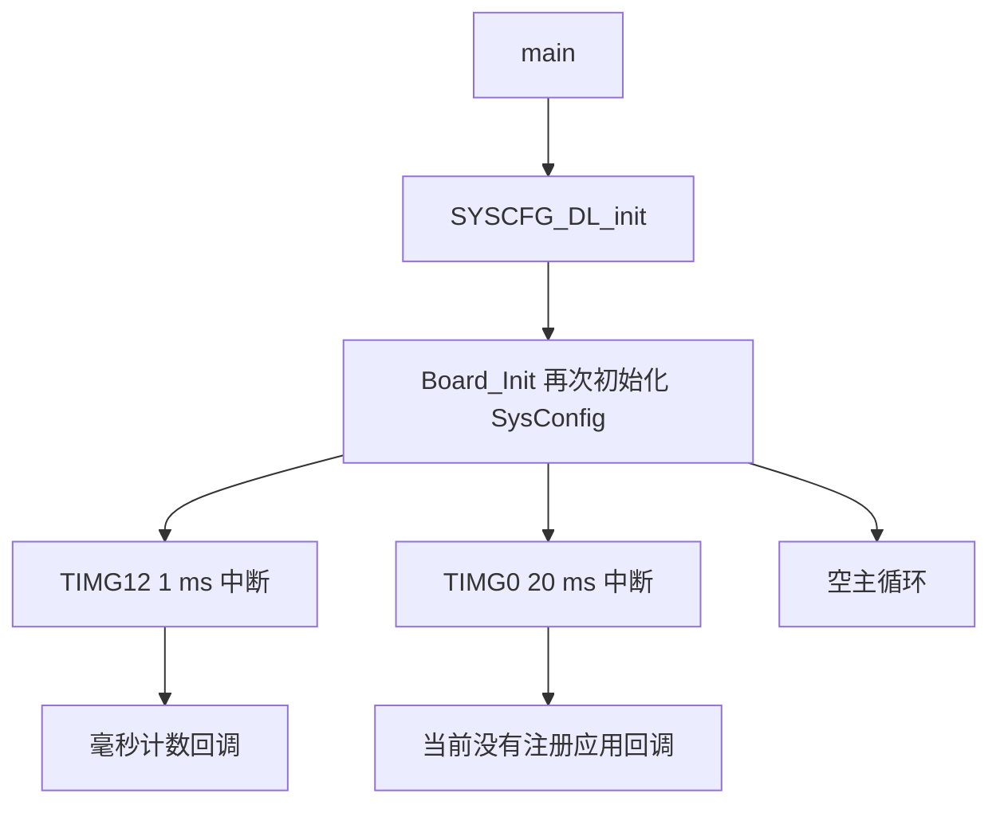

# MSPM0 工程分析与后续开发依据

**归档说明**: 本文记录 2026-10-14 对 ti_cup 固定分支的分析。
2026-10-15 复制至本工程保留历史依据，旧 SDK、绝对路径和命令
不代表当前工程配置；当前开发范围以 pvc_control_plan.md 为准。
Debug 内归档构建/迁移脚本不应作为当前工程的日常构建入口。

**分析日期**: 2026-10-14。

**后续参考顺序**: 用户明确指定 2026h 是最新应用，优先参考它的实际使用方式。
深入分析见 [2026h 应用分析](2026h_application_analysis.md)。
本文以下主要分析 main 的公共驱动基线，不能直接代替 2026h 的应用契约。

**基线**: main，提交 e09a1dd。开始时工作区干净。

**结论**: 该工程可作为 MSPM0G3507 公共驱动基线，但尚未组成完整应用。
现有主机测试和本机固件编译通过；部分硬件时序、并发和输入边界仍需处理。
本次仅新增分析文档，未修改固件、切换分支、提交或操作目标板。

## 初步事实

- 当前分支 main，分析开始时工作区干净。
- main.c 为公共基线入口，while 循环为空。
- Board_Init 仅启动双 PIT 和毫秒 tick，未初始化设备模块。
- main 和 Board_Init 均调用 SYSCFG_DL_init，存在重复初始化。
- README 和 CLAUDE.md 部分描述已过时，后续结论以源码为准。
- 本机存在 Debug/main_validation/build_validation.py 和软件测试脚本。

## 官方入口

- [MSPM0G3507 产品资料](https://www.ti.com/product/MSPM0G3507)
- [器件数据手册](https://www.ti.com/lit/ds/symlink/mspm0g3507.pdf)
- [TI 官方 SDK 仓库](https://github.com/TexasInstruments/mspm0-sdk)

## 已确认的控制与时序事实

- PID 为增量式，Ki/Kd 已包含固定采样周期的影响。
- Motor_SetSpeed/LR 为速度参数到 PWM 的开环映射，模块内部无 PID。
- 编码器按 A 上升沿读取 B，330 脉冲/输出轴转为当前代码假设。
- 20 ms 控制 tick，3 tick 测速窗口，即每 60 ms 更新速度。
- IMU dt=0.01 s，但头文件建议 2 ms；不能按旧注释安排调度。
- 舵机配置实际计数频率 5 MHz、周期 20000，即 4 ms。
- 超声波使用 1 MHz、20 ms 回绕计数器，仅能获得模 20 ms 脉宽。
- I2C_Write 只填一次 FIFO，忽略实际填入数量；OLED 每次仅传 2 字节。
- UART_PrintfDMA 跨句柄共享静态缓冲区，仅等待当前句柄 DMA 完成。
- KEY GPIO 使用上拉，软件四个按键均设高有效，需核对接线。
- GPIOA 组中断定义在 motor.c，同时分发超声波，存在模块耦合。

## 自动验证结果

- 主机软件测试通过：PID、协议边界、UART 边界及总线超时。
- SysConfig 1.26.2 + SDK 2.10.00.04 重新生成成功，生成文件未变化。
- TI 编译器 4.0.4.LTS：27 个源文件编译并链接成功。
- 编译产生两个 PIT switch 未覆盖枚举值警告。
- 链接 MAP：FLASH 已用 0x1d90=7568 B；SRAM 已用 0x407=1031 B。
  主循环未启用设备，大量未引用函数被链接器移除，不能代表完整应用。
- 通用 cppcheck 技能扫描 modules（warning）零发现。
  补齐工程和 SDK include 后扫描亦完成，但 CMSIS 报 Unknown compiler。
  该扫描未完整模拟 TI 编译器预定义宏，只能提供辅助线索。
  不能据此认为已覆盖运行时问题，也未进行 MISRA 合规认证。

## 官方依据

- [SDK 2.10 发布说明](https://software-dl.ti.com/msp430/esd/MSPM0-SDK/2_10_00_04/release_notes_mspm0_sdk_2_10_00_04.html)
- [SDK 中文索引](https://software-dl.ti.com/msp430/esd/MSPM0-SDK/2_10_00_04/docs/chinese/MSPM0_SDK_Documentation_Overview_CN.html)
- [器件勘误 Rev. H](https://www.ti.com/document-viewer/lit/html/SLAZ742)

器件提供 MATHACL，但当前浮点计算不会自动变为 MATHACL 操作。
生成时钟代码包含 SYSPLL_ERR_01 检查，故不能以旧模板替代。

## 1. 工程定位与分支

当前 main 的实际应用目录仅有 application/comm。
README 所列 main.md、board.md、application/pid、state_machine 等路径不存在。
CLAUDE.md 所述 DWT 延时、ADC 灰度、无 CLI 构建及分支目录也与现状不同。
这些描述不适合直接作为新工程的开发依据。

只读检查本地分支的结果如下。已补充构建 2026h，其余分支未构建。

| 分支 | 当前可见的应用内容 |
|---|---|
| main | 入口模板、公共驱动、comm |
| 2024h | 入口调用 Chassis，但该分支文件树未找到对应 chassis 实现 |
| 2025e | 当前入口为 IMU 显示测试，另有旧 chassis/gimbal 应用 |
| 2026h | 最新比赛应用：任务菜单、循迹、视觉球平衡、前馈和遥控；主要参考 |
| 2026h-dev | 后续 UI/控制改动，可对照限幅与绝对坐标实现，未构建验证 |
| 2026-sim-car | 较早的循迹/视觉接管、电磁铁、云台使用示例 |
| 2026-sim-display | 较早的通信驱动显示、计数计时及状态反馈示例 |

模拟赛两个分支各自根目录为 CCS 工程，并非旧文档所述 car/display 子工程。

继续类似工程时，应根据具体应用内容选择基线，并逐项比较
main.c、board.c/h、empty.syscfg 和 application，不能全盘覆盖赛题配置。

## 2. 真实运行链路



SysConfig 初始化实际包括电源、GPIO、时钟、PWM、PIT、I2C、UART、SPI、DMA。
两个 PIT 自动启动，但 Motor、Key、Buzzer、IMU、OLED、Servo、Comm 的
软件 Init/Update 尚未接入，因此“已配置外设”不等于“模块已运行”。

PIT 回调在中断内执行，按注册顺序同步调用，各最多 8 个。
Init 只使能 NVIC，不清空回调表；重复模块初始化会重复注册。
RegisterCallback 返回失败，但现有调用方大多忽略返回值。
当前未显式设置 NVIC 优先级，新增实时任务时要核对优先级和最坏执行时间。

推荐后续启动顺序：一次硬件配置 → 安全输出 → 模块状态初始化及回调注册
→ 使能任务中断 → 主循环。具体改动应依据目标应用设计。

## 3. 外设与引脚依据

以下来自当前 empty.syscfg 和本次生成的 ti_msp_dl_config.c/h。
只代表软件配置，未与实物接线或原理图比对。

| 功能 | 外设/引脚 | 时序或约束 |
|---|---|---|
| CPU | MSPM0G3507，LQFP-64 | 80 MHz，Cortex-M0+，soft float |
| 快速 tick | TIMG12 | 10 MHz，LOAD=9999，1 ms |
| 控制 tick | TIMG0 | 1 MHz，LOAD=19999，20 ms |
| 电机 PWM | TIMA0 C0=PB14、C1=PA22 | 80 MHz，10000 计数，8 kHz |
| 电机方向 | M1=PB0/PB21、M2=PB8/PB24 | TB6612，左右安装方向镜像 |
| 编码器 | M1 A=PA15/B=PA24，M2 A=PA7/B=PA17 | A 上升沿中断，读取 B 判向 |
| 舵机 PWM | TIMA1 C0=PB2 | 5 MHz，20000 计数，250 Hz |
| BMI088 SPI | SPI0，SCLK=PA12、MOSI=PA14、MISO=PA13 | 8 bit，MSB first，POL0/PHA0 |
| BMI088 CS | ACC=PB13、GYRO=PB15 | 生成 GPIO 初始状态均为低 |
| OLED I2C | I2C0，SDA=PA28、SCL=PA31 | 400 kHz，地址 0x3c，外部上拉需核对 |
| 调试 UART | UART0，TX=PA10、RX=PA11 | 115200、8N1，TX DMA channel 0 |
| 树莓派 UART | UART1，TX=PB6、RX=PA9 | 115200、8N1，当前仅配置 RX 中断 |
| 按键 | PB18/PB23/PB19/PB10 | 四路上拉输入，软件配置高有效 |
| 灰度 | PB12/PB4/PB1/PB17/PB9/PB16/PB20/PB11 | 八路数字输入，返回低有效位图 |
| 蜂鸣器 / LED | PB5 / PB22 | 蜂鸣器为低有效 GPIO 开关 |
| 超声波 | TRIG=PA16、ECHO=PA8 | ECHO 双边沿，复用 TIMG0 |
| TM1637 | CLK=PB3、DIO=PB7 | GPIO 模拟专用协议 |
| SWD | SWCLK=PA20、SWDIO=PA19 | 后续配置保留调试引脚 |

舵机若使用常见 50 Hz 器件，需要按器件规格配置 20 ms 周期。
不能只把 5 MHz 下的 period 改为 100000：TIMA1 是 16 位定时器，
应先降低计数频率，再调整周期和脉宽换算。

## 4. PID 与电机控制契约

PID 实现位于 modules/algorithm/pid/pid.c，计算过程是：

```text
e[k] = target - feedback
I[k] = clamp(I[k-1] + e[k], ±integral_limit)
Δu = Kp*(e[k]-e[k-1]) + Ki*(I[k]-I[k-1])
     + Kd*(e[k]-2*e[k-1]+e[k-2])
u[k] = clamp(u[k-1] + Δu, ±output_limit)
```

这不是每次直接计算绝对输出的位置式 PID。参数含采样周期影响，
更换调用周期时应重新换算或调参，不能照搬 Ki/Kd。
积分限幅约束的是累计误差，输出限幅与实际执行器饱和反馈尚未联动。
PID_Reset 清历史及输出，但保留目标和参数；切换运行模式时需明确目标策略。

Motor_SetSpeed/LR 将 mm/s 按最大速度比例映射到 PWM。
反馈测速存在，但不参与该函数，应用层还需建立真正的速度闭环。
接入 PID 时必须先明确输出单位是 PWM 计数、占空比还是速度校正量。
若 PID 输出为 PWM，不能直接当 mm/s 传给 Motor_SetSpeedLR。

测速假设为 11 线、30 倍减速、A 相单上升沿，即 330 脉冲/输出轴转。
当前公式写死 100/11，未使用头文件的编码器参数宏，改宏不会同步改公式。
轮半径代码为 68 mm，是否实际为直径必须测量确认。
速度每 60 ms 更新一次，EMA 增益 0.25，会引入额外滞后；
20 ms 控制环可能连续三次读取同一反馈，应在调参时考虑。

最先验证轮子手动正转的脉冲方向、整转脉冲数和实际轮径，
再做开环占空比测试和单轮闭环，最后加入双轮协调、循迹或姿态外环。

## 5. 问题优先级与验证方法

下列是源码和配置推导，尚未作为本次固件改动实施。
优先级按启用相关功能后的影响排序，不表示当前空主循环已触发故障。

| 优先级 | 位置 | 发现与影响 | 下一步验证 |
|---|---|---|---|
| 高 | empty.syscfg / servo.c | 舵机周期实际 4 ms；是否可接受取决于舵机规格 | 示波器核对周期及 1/1.5/2 ms 脉宽 |
| 高 | imu.h:9、28 | dt=10 ms，但注释建议 2 ms，按注释调用会使积分时间比例不符 | 固定调用周期，记录时间戳，验证已知角速度 |
| 高 | ultrasonic.c:157 | 只算模 20000 的计数差，超过 20 ms 的回波无法还原 | 注入 19/20/23 ms 脉冲和跨周期脉冲 |
| 高 | uart.c:173 | 多 UART 共用 PrintfDMA 静态缓冲，仅等待当前句柄，另一实例可改写在途数据 | 两路 DMA 交错发送并核对字节 |
| 高 | uart.c:260、305 | 主循环与满缓冲 ISR 都修改 rxRawTail，读改写可能竞争 | 满缓冲与读操作交错测试 |
| 高 | oled.c:82 / comm_handler.c | 命令可携带任意非零字符；chr-' ' 未检查字库范围，可能越界读取 | 输入控制字节、0x80 和 UTF-8 文本 |
| 中 | key.c:13、69 | 上拉与高有效须核对接线；PRESSED 状态未在重新按下时清释放计数，非连续消抖 | 用真实高低电平序列验证事件时刻 |
| 中 | motor.c:155 / ultrasonic.c:93 | 超声波组 ISR 放在 motor.c，Ultrasonic_Init 本身不使能 GPIOA NVIC | 仅启用超声波、禁用电机时验证回波 |
| 中 | bmi088.c / 生成 GPIO | 双 CS 初始均低，Init 未先全部释放；初始化没有有效 ID/配置回读失败上报 | 冷启动和 MCU 单独复位，核对 CS/MISO/ID |
| 中 | i2c.c:128 | 一次填 FIFO，忽略填入数量，没有长传输续填或分块 | 发送超过 FIFO 容量的数据 |
| 中 | i2c.c:157 | 恢复采用最多 100 个 2 ms 时钟，可能阻塞约 200 ms，未显式生成 STOP 或上报失败 | SDA 持续拉低及 NACK 故障注入 |
| 中 | main.c:12 / board.c:22 | 重复 SysConfig 初始化会复位外设；PIT 回调注册也不具备幂等性 | 明确唯一初始化入口，验证重复调用策略 |
| 中 | motor.c:199、256 | 有符号累计计数长时间运行有溢出风险；运行中复位多字段可能与 ISR 竞争 | 边界计数、复位与 ISR 交错验证 |
| 中 | tools/protocol_test.py:26、128 | PC 编码帧缓冲上限 64，小于 MCU 最大 67 个编码字节，满载帧会被截断 | 0～64 字节载荷跨语言往返 |
| 中 | tm1637.c:181 | num=-32768 取反再存 int16_t 可能仍为负，随后字库索引可为负 | INT16_MIN 输入边界验证 |
| 低 | pit_tick 两个 ISR | switch 无 default，当前只开 LOAD 中断，产生编译警告 | 启用其他中断前明确分发策略 |

UART_SendStrDMA 直接使用调用者内存，调用者必须保持缓冲区到 DMA 完成为止。
阻塞 UART_Printf 也有共享缓冲，不能假定可从主循环和中断同时调用。
UART 的轮询超时是次数，不能解释为毫秒；DMA 超时不提供返回状态。
I2C/SPI 也未提供明确的错误传播接口：SPI 超时返回 0 与合法数据无法区分。
这些接口限制应在需要相应功能时用最小改动处理，不必先重写整个 BSP。

OLED_Clear 发送 8*(128+3)=1048 次两字节 I2C 事务。
按地址加两数据字节、每字节 9 位估算，400 kHz 总线仅传输就约 71 ms，
尚未计入软件及 START/STOP 开销。显示刷新不宜放进 1 ms ISR。
Comm_Update 的同步命令处理也会因此延迟 UART 环形缓冲的消费。

Protocol 和 PH 均有单例状态，不能直接绑定多路 UART，
也不能让两个解析器同时消费同一个原始 RX 环形缓冲。
当前 Comm 只处理 0x13 OLED，提供 0x22 距离、0x2f 状态上报；
imu_report_ms 字段尚未实现。PC 工具中定义命令并不表示 MCU 已支持。

## 6. MSPM0 专有知识与官方资料核对

MSPM0G3507 提供 128 KiB Flash、32 KiB SRAM、DMA、MATHACL 和定时器。
资源能力以 [TI 产品资料](https://www.ti.com/product/MSPM0G3507) 为准。
该项目使用 DriverLib 和生成宏，不能直接套用 STM32 HAL、DWT 或 Cortex-M4
故障寄存器模板。核内无 FPU；MATHACL 需明确调用，不会自动加速普通 float。
当前 invSqrt 实际为 1/sqrtf，Mahony_Output 每次计算反三角函数。
优化前应先用 GPIO 翻转和示波器测量 IMU/PID 最坏执行时间。

官方勘误按实际硅片 revision 核对，本次未读取硬件版本。
相关条目的适用条件如下，不能一律认定当前工程受影响：

- SYSPLL_ERR_01：本次生成代码已有 PLL 锁定检测及重试。
  该重试可能持续阻塞；异常启动需结合硬件和具体生成代码排查。
- [TIMER_ERR_01](https://www.ti.com/document-viewer/lit/html/SLAZ742H/GUID-XXERRATA-CD0T-XX01-XXXX-0000107329.2)：
  若后续改硬件捕获，避免直接照搬以 ZCOND/LCOND 启动的捕获方案，
  按官方捕获示例采用对应规避。
- [TIMER_ERR_06](https://www.ti.com/document-viewer/lit/html/SLAZ742H/GUID-XXERRATA-CD0T-XX01-XXXX-XX0000108806)：
  停止计数器应控制 CTRCTL.EN，而非仅禁用 CCLKCTL.CLKEN。
- [UART_ERR_11](https://www.ti.com/document-viewer/lit/html/SLAZ742H/GUID-XXERRATA-CD0T-XX01-XXXX-XX0000109995)：
  若启用 RX timeout，需按条目核对 RXTOSEL；当前没有启用该中断。
- [UART_ERR_01](https://www.ti.com/document-viewer/lit/html/SLAZ742H/GUID-XXERRATA-CD0T-XX01-XXXX-0000108137.1)：
  与 STANDBY1 中重复 UART 起始条件有关，当前主循环没有进入该模式。

BMI088 加速度计 SPI 读多一个 dummy byte 的处理在当前代码中已实现。
但上电模式切换与正常采样前的时序仍需结合双 CS 初态核对；
不能把“读数据时的 dummy byte”和“上电切换 SPI 的操作”混为一谈。
依据为 [Bosch 数据手册](https://www.bosch-sensortec.com/media/boschsensortec/downloads/datasheets/bst-bmi088-ds001.pdf)
第 3 和 6.1 节。初始化目前总是返回成功，IMU 也没有处理失败；
无效 gyro ID 时保留旧数据，应用层无法获知数据失效。
六轴姿态解算的 yaw 无绝对航向观测，长期航向任务需处理漂移。

后续优先查本机 SDK 2.10 示例，而不是只看最新 SDK 的函数签名。
本机同时安装 2.11，不意味着本工程已经升级。

| 需求 | SDK examples/nortos/LP_MSPM0G3507/driverlib 下的参考 |
|---|---|
| I2C 长数据发送 | i2c_controller_rw_multibyte_fifo_poll / fifo_interrupts |
| UART TX DMA | uart_tx_multibyte_fifo_dma_interrupts |
| UART RX DMA | uart_rx_multibyte_fifo_dma_interrupts |
| GPIO 捕获 | gpio_input_capture |

上述目录已在本机确认存在；具体移植仍需重新选择引脚、DMA 和中断。

## 7. 本机工具与复现命令

| 工具 | 本次状态 | 适用范围 |
|---|---|---|
| CCS 工程配置 | 已读取 .ccsproject/.cproject/.project | IDE 标准导入与构建 |
| SysConfig 1.26.2 | 已运行 | 检查配置，生成设备宏和链接脚本 |
| tiarmclang 4.0.4.LTS | 已运行 | 本机固件编译链接 |
| 主机 GCC 16.2.0 | 已运行软件测试 | 与 mock 接口绑定的驱动回归 |
| cppcheck 2.21.0 | 已运行，预定义宏存在限制 | 辅助静态检查 |
| TI tiarmsize / MAP | 已运行 | TI ELF 的链接资源占用 |
| tiarmclang-tidy | 编译器 bin 中存在，未运行 | 需要正确的编译数据库 |
| gdb-multiarch 17.1 | --version 成功 | 符号调试客户端 |
| J-Link GDB Server | 常见路径找到 V4.90，未运行 | 设备支持及探针连接尚未验证 |
| OpenOCD | PATH 未发现 | 不认定系统其他位置不存在 |

J-Link 检测技能脚本因 shared/tool_config 缺少 set_tool_path 导入失败。
旧 V4.90 安装目录下的程序不能据此认定支持 MSPM0G3507。
CCS 的 J-Link 配置存在，但本次没有做连接、复位或下载测试。
[SEGGER 的 MSPM0G 文档](https://kb.segger.com/TI_MSPM0G) 可用于核对设备支持。
不能把该技能的 SWO 能力直接用于 MSPM0G3507；Cortex-M0+ 无 SWO，
见 [SEGGER 官方说明](https://www.segger.com/downloads/jlink/UM08024_JLinkOBSTM32F072.pdf)。
该项目优先用 UART 或 GPIO 时序测量观察运行情况。

工程根目录下运行软件测试：

```powershell
python tools\run_software_tests.py
```

本机固件验证流程：

```powershell
& E:\ti\ccs2050\sysconfig_1.26.2\sysconfig_cli.bat `
  -s E:\ti\ccs2050\mspm0_sdk_2_10_00_04\.metadata\product.json `
  --script E:\ti\projects\ti_cup\empty.syscfg `
  -o E:\ti\projects\ti_cup\Debug\main_validation --compiler ticlang

python Debug\main_validation\build_validation.py

& E:\ti\ccs2050\ccs\tools\compiler\ti-cgt-armllvm_4.0.4.LTS\bin\tiarmsize.exe `
  Debug\main_validation\main_validation.out
```

build_validation.py 已存在于忽略目录 Debug，含本机绝对路径，未被 Git 跟踪。
当前可使用，但全新克隆不会自带它；也不等同于已经实测 CCS GUI Build。
新工程若需命令行构建，应在具体开发任务中提供受版本管理的构建入口。
CCS 的源排除规则与该验证脚本目前一致：tests、modules/zdt_motor、
application/gimbal 被排除。zdt_motor 的 MOTOR_INST 映射在当前配置不存在，
因此本次不能声称所有仓库模块都已编译验证。

FLASH 用量 7568/131072 B，约 5.77%；SRAM 1031/32768 B，约 3.15%。
MAP 中 SRAM 包含 512 B 预留栈，数据和 BSS 共 519 B。
没有测量运行时最大栈深度，启用 printf、姿态解算及中断嵌套后需重新评估。

## 8. 后续开发顺序与验收

1. 明确目标板、实际外设和应用分支；建立引脚、定时器、DMA 清单。
   验收：SysConfig 生成成功，宏与实物接线逐项一致。
2. 清晰定义一次初始化、GPIO 组中断职责和固定周期调度。
   验收：1/20 ms tick 实测正确，回调不重复，最坏执行时间可接受。
3. 按需求修复并启用单个模块；先通信、输入和采样，再输出控制。
   验收：边界回归通过，外设时序正确，异常数据可以被应用识别。
4. 先调单环，再接入串级控制或任务状态机。
   验收：单位、方向、周期、限幅及反馈延迟全部明确，遥测可解释响应。
5. 加入显示与通信上报，控制刷新频率，实测运行栈和丢帧情况。
   验收：控制周期不因 OLED/串口阻塞失守，整机长时间运行结果可复现。

本报告已足以继续讨论和实现类似工程的具体模块。
仍未知的硬件事实包括接线、轮径、编码器实测 PPR、舵机规格、
BMI088 板级供电及探针实际支持；这些不能用编译或 mock 测试代替。


## 2026-10-15 分级编译首版实现

1. [已完成] 参考 VANGUARD 统一配置与 STAGE，设计四级裸机应用。
2. [已完成] 实现视觉协议、统一转向/驱动与启停停车。
3. [已完成] 加入相对 pitch 判断和 10 ms 调度。
4. [已完成] 主机行为测试、四级固件编译链接、说明联调步骤。

默认仅收帧，不自动启动；不改 ti_cup，不提交或推送。
只参考分层及分级写法，不移植 STM32 HAL/RTOS 或机器人机构。
参考工程隐藏 pip 临时目录拒绝访问，改查 application/Core；
文档的 vision 子目录路径过时，实际为 communication_bond/vision.c。


### 首版实现与验证结果

- 新增 car_config、car_app、race、chassis、vision、slope，按四级裁剪。
- main 去掉重复 SYSCFG 初始化；按键极性修正为匹配上拉的低有效。
- SysConfig 未改，CCS 仅增加新模块头文件路径。
- CAR_STAGE 默认 1，只收帧；二级以上本地按键显式启动，停止优先。
- 四级完整编译链接各 29 个源文件，只有两个原有 PIT switch 警告。
- 真实协议/比赛/坡道/底盘代码的四级主机测试通过，原驱动回归通过。
- 测试初次失败是损坏帧构造同时修改 seq 和校验，恰好抵消；
  改为先重算合法校验再注入单字节损坏，四级测试通过。
- 输出前重新读取毫秒时间，避免同步 IMU 调用耗时掩盖观测过期。
- 说明和操作步骤见 application/car_app.md。增益/PWM/阈值均待实车调试。
- 未烧录、未上板驱动，未修改 ti_cup 或 VANGUARD，未提交或推送。


## 2026-10-17 OLED 菜单移植

前置提交 eca2b97 已完成，作为 OLED 改动基线，未推送。

1. [已完成] 参考 Astra 列表/选择框/页面交互，复用 C/I2C 框架。
2. [已完成] 实现画布、增量小块刷新及失败隔离。
3. [已完成] 接入运行、视觉、pitch、配置菜单与现有按键。
4. [已完成] 主机测试、画面检查、四级固件编译和联调说明。

Astra 原工程采用 GPLv3、C++/u8g2/SPI；本次参考交互和架构，
用现有字库独立编写 C 菜单，不复制其 C++ 或 u8g2 源码。
KEY1/KEY2 保持启停，KEY3 切换、KEY4 进入/返回，配置先只读。
不改 ti_cup 或参考工程，不烧录，不自动提交 OLED 改动。

### OLED 完成边界

- C/I2C 首版菜单已接入，默认启用，默认 CAR_STAGE 仍为仅收帧。
- 新增 1024 B 画布与 1024 B 已发送缓存，按最多 7 字节脏块刷新。
- 新短 I2C 写路径不进入延时恢复，连续五次显示失败后隔离显示。
- OLED 和短 I2C 主机测试通过，四级完整固件各 31 个源文件链接通过。
- 真实画布生成并检查了主菜单、视觉和 pitch 预览，布局无截断。
- GPIO 与 I2C 速率未改，二级以上的 KEY1/KEY2 启停语义保留。
- 编译仍保留两个原有 PIT switch 警告；实际屏幕和传输耗时未实测。
- 前置提交 eca2b97 已完成；本次 OLED 变动保留未提交，未推送/烧录。
## 2026-10-17 OLED 原版观感对照

本机 Astra 演示 GIF 展示磁贴首页：大图标横向排列、固定四角选中标记，
顶部进度条、底部虚线和居中标题；列表使用约 16 像素行距与实心反白。
旧移植版的标题/提示占据屏幕上下两端，四个 10 像素行挤在中间，
空心选择框与原版风格差异明显。
本次使用现有 6x8 字库和独立图元绘制四种图标，参考布局而不引入 C++/u8g2。
刷新每块额外等 1 ms 会降低动画实际帧率，现保持每主循环一个小块，取消额外等待。

## 2026-10-17 Astra 动画机制及四键研究

已浏览用户给定仓库和 Wiki，下载 main 源码，提交 88716a6。
重点核对 item.h、selector.cpp、camera.cpp、menu.cpp 和 launcher.cpp。
原版选择器的位置/宽/高、菜单项、视角各自趋近目标，跨页保留过渡形状，
列表采用 16 像素行高、反白框与视角边界滚动，而不是切换静态详情。
旧实现 KEY1/KEY2 被启停占用，默认一级又不允许动作，导致两键不能导航；
详情没有选中行和滚动，进入/返回直接重设坐标，缺少对应的动画对象。
本次四键统一上下确认返回，运行页提供显式 Start/Stop，返回同时发布停止。
仅改变 UI 意图接入，启动检查仍在 car_app/race，不由 UI 操作执行器。
同页连续写入利用 SSD1306 自动增列，避免每七个数据字节重发定位命令。
动画按毫秒推进；主机以估计线时模拟，输出已完成传输的动画帧供检查。

## 2026-10-17 视觉偶发接收与原始诊断

用户确认仍是 13 字节二进制且 seq 每帧递增。
原解析器已有滑动窗口重找帧头；Age 只跟随接受的新帧，不能代表串口字节年龄。
现有 SysConfig 的 UART3 为 115200/8N1，SDK DL_UART_init 清除 FIFO 使能，
原 RX ISR 每次仅读一个字节，没有原始字节与错误分层诊断。
新增 FIFO/一字节阈值及接收超时，有界排空，RXDATA 单次读取兼取错误位。
队列满时丢弃新字节，ISR 不改消费者 tail；可用长度改用 head/tail 局部快照。
协议增加原始历史、字节年龄、SYNC 及尾/校验/范围/序号失败分类，不放宽帧格式。
实机故障原因尚未确认，需用 HW/APP、DROP/OVR/ERR 和 T/C/R 分层定位。
## 2026-10-20 调参同步检查

Control 原有四项已读取 CarTuning_Get，未复现旧值缓存，但缺另外五项参数。
已统一九项顺序与格式；Run status 的输出项改名 PWM out，区分目标与输出。
新增回归通过真实菜单编辑全部参数，进入 Control 对照数值、
恢复默认并核对模拟 SSD1306 已接收画面；预览已人工检查。
短暂丢线时旧方向未使用新 Limit，已把限幅移到观测可用判断之外。
转向目标可覆盖更低直道目标，已改成两者取小，保留参数独立值。
停车测试的固定 250 ms 窗口不适应 3000 PWM，现推导等待时限。
保留阈值大于 Limit 则不触发转向降速的配置语义，说明中明确记录。

## 2026-10-20 转向变化率接入

当前 race_output_t 只有实际转向字段，需增加目标字段供降速和诊断使用。
参数表追加第十项后列表含标题及末项共 12 行，现有容量正好可容纳。
运行页增加 Turn target 并把原 Turn 标为 Turn out，Link 行将后移。
控制采用真实 dt，转向推进最多按两个控制周期计算，避免卡顿后一次大跳。
已接入 Steer slew=800，范围 0～3000、步长 100，0 为直通。
丢线或观测年龄达到 50 ms 时把目标冻结为当前输出；新 Limit 始终立即执行。
速度切换使用目标/输出的最大绝对值，停止和终点完成同时清零两种转向。

## 2026-10-21 低速与急弯反打

直接核对旧 2026h 分支：Motor_SetSpeed/SetSpeedLR 仍是线性开环 PWM 映射，
没有轮速反馈调节。其最大映射速度由 300 RPM 和轮半径宏 68 mm 算得约 2136 mm/s，
命令 800 对应约 3744 PWM。这个映射不能证明真实车速。
旧 Task2 的直/弯目标同为 800；tracking.c 另按转向乘差速增益，
用 base+diff/base-diff 调用 Motor_SetSpeedLR。当前底盘采用相同 PWM。

当前代码默认直道 3000、弯道 2100、降级 300；坡道再乘 0.65，
分别变为 1950、1365、195。菜单运行时参数可能与编译默认不同。
调速函数名称不决定快慢，实际 PWM、降速原因与负载才需要一起核查。

Debug/steering_diagnosis 用真实 Race 控制器回放：
从 +60 切到 -60，slew=800 时 10/40/70/80/150 ms 输出为 +52/+28/+4/-4/-60；
slew=0 时下个控制周期直接输出 -60。因此短时间目标与输出反号可能来自电控滞后。
另一组输入 dev=0.30、k=-0.20，在 KP=50、KH=100 时 P=15、H=-20，
目标为 -5；把 KH 改为 0 后目标为 +15。此例说明加权会换号，不证明视觉错误。

定位顺序：先低速用 Steer slew=0 隔离平滑，再只把 KH=0 隔离航向项。
目标反号时检查两项加权及原始输入；目标正确而输出暂时反号检查平滑；
输出正确而机械方向相反才检查安装方向与中位。
尚无实车切换日志，不能把回放中的可能机制当作已确认根因。

## 2026-10-21 motor 分层迁移

用户强调接口分层，速度命令的动机不是把接口误认为闭环。
当前 application/chassis 直接操作 TB6612 的计数和极性，需要收回 motor。
Motor_Init 尚未启动 PWM 定时器，迁移初始化时应补齐 TB6612_Init。
motor.h 目前透出 TB6612 的 PWM 宏，准备改为模块内实现细节。
初查把 board.c 路径写成 bsp/board/board.c，实际文件位于工程根目录。
已改为 Chassis -> Motor_Init/SetSpeed/Brake，Motor_Init 补齐 PWM 启动。
PWM 上限与电气极性归 motor 实现，公共速度上限用于调参范围，不再限制为 40%。
默认 640/450/65 mm/s，斜坡 427/2136 mm/s²，保留接近原驱动力和响应。
菜单与控制状态字段均改为速度单位，未加入差速或闭环。

## 2026-10-21 坡道速度分离

用户已将本地直道/转弯/降级速度改为 1200/800/300，需保留。
旧 car_app 对所有非平路乘同一个 0.65，且 Race 再把比例钳为不大于 1。
两处都需修改，否则新增上坡参数不能真正提速。
上坡放大不可突破速度模块上限，也不可放大视觉降级上限。
已拆分为 Up/Crest/Down scale，默认 1.25/0.80/0.65。
上坡允许 0.10～2.00，坡顶和下坡为 0.10～1.00，步长均为 0.05。
Race 先按比例缩放并钳位到 motor 上限，再应用不被上坡放大的降级上限。
原坡顶状态在恢复水平后只持续约 100 ms；速度按减速率变化，可能尚未到达目标。
本次未修改坡道状态判定；联动测试明确覆盖倒装方向和该短暂窗口。

## 2026-10-22 差速辅助

已只读核对旧 2026h：tracking.c 使用 servo × gain 的绝对差速量，
base+diff/base-diff 调用 Motor_SetSpeedLR。当前 chassis 两轮同命令。
本次由 chassis 根据 turn_right 分配两轮，与 Race 的转向平滑方向一致。
差速使用基础命令的比例，避免低速时固定差速导致内轮反转；外轮饱和时两轮共同缩放。
小转向保持同速，超过阈值连续介入，达到当前 Limit 时达到最大比例。
阈值大于等于 Limit 时关闭辅助，最大比例 0 同样关闭。
实际规格为阈值 0～100、步长 5，比例 0～0.50、步长 0.05。
原 Race 的速度继续表示分配前基础命令，单轮可高于此值，文档已明确降级语义。
共同缩放发生后两轮均值低于基础命令；此策略没有改变现有速度斜坡或引入反馈。
主机已覆盖跟随输出方向、连续介入、比例限幅、运行中修改、关闭和失效制动。

## 调参页启停

菜单仍只发布 CAR_MENU_ACTION_START/STOP，由 Car_Update 执行原有门控。
Debug tune 顶部增加两行，参数起始行由 1 调整为 3，Control 顺序保持。
同步调整参数格式化、编辑映射和恢复默认行，容量由 16 扩为 18。
