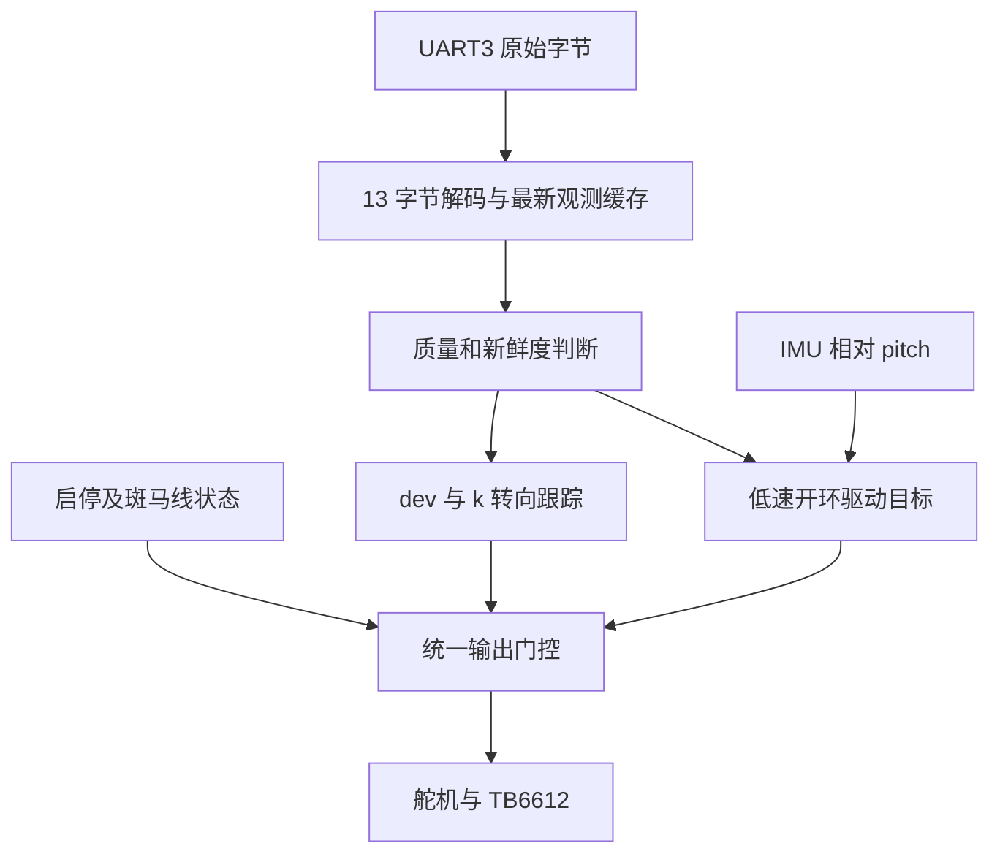

# PVC 低速视觉跟踪实现方案

**更新日期**: 2026-10-15。
**工程目录**: E:/ti/projects/2026_smart_car。
**题目来源**: references/2026智能汽车校赛选拔赛开题.pptx，第 6～8 页。
**当前范围**: 整理实现方案，尚未编写或上板验证比赛控制程序。

## 1. 本阶段已经确定的条件

- 沿用同一辆舵机转向、双电机小车，先低速跑通视觉参考路径。
- 路障尚未识别，本阶段按无路障场景调试，不实现避障。
- 视觉不识别坡道，仅根据 IMU pitch 变化判断坡道并调整驱动量。
- 十字固定直行；环岛需要转向时，视觉提供对应的参考路径误差。
- 电控不选择十字分支、环岛出入口，不生成独立元素轨迹。
- 轮速闭环和里程暂不使用，不要求轴距、轮径、赛道尺寸等几何参数。
- 视觉帧率暂按约 60 Hz 估算，接入后记录实际新帧间隔核实。
- 分析文档及证据统一在本工程维护；ti_cup 只作只读来源。

题目仍要求路障等元素，本阶段忽略路障属于开发范围缩减，
不代表完整比赛功能已经满足。赛道宽度、半径等无需先测出才能低速联调。

## 2. 赛道与分工

PVC 专门规则是斑马线发车、经过不同元素、返回斑马线后停车，元素顺序不定。
第 6 页通用车库说明和第 9～10 页微缩赛道规则不混入当前实现。
第 7 页参考图的 35.86 m 不作为精确圈长或停车门槛。


道路是白色路面、黑色边界，与旧 2026h 的黑色中心线灰度循迹不同。
视觉已负责识别道路、补线并确定应跟踪的参考方向。

| 视觉负责 | 电控负责 |
|---|---|
| 输出当前参考路径的 dev/k | 计算舵机量、限幅和必要滤波 |
| 十字直行及环岛参考方向 | 持续跟踪误差，不等路段标签才转向 |
| valid、lost 和测量序号 | 质量判断、帧新鲜度与失效处理 |
| 斑马线观测 | 起点屏蔽、返程标记确认及停止输出 |
| 可选 elem/phase 标签 | 日志或辅助降速，不选择出口 |
| 不识别坡道 | 根据相对 pitch 判断坡道并调整驱动量 |

视觉提供误差，不直接给舵机角度、PWM 或左右轮转速。

## 3. 当前控制链



没有轮速闭环，因此驱动目标不称为已经实现的实际车速。
先使用小的开环驱动量和起步斜坡；转向大或测量质量变差时适当降低驱动量。
同样 PWM 在不同电池电压、坡度、摩擦条件下，实际速度会变化。
这不阻止先在低速场景联调。

当前 Motor_SetSpeedLR 是名义 mm/s 到 PWM 的开环换算，
若沿用它，参数仅作名义速度目标；若直接使用 PWM，则沿对应 PWM 接口输出。
不能把 PWM 单位的控制输出再次传入 mm/s 接口。

## 4. 转向控制与 k 的分辨率

| 量 | 定义 | 编码 | 解码 |
|---|---|---|---|
| dev | 横向位置误差，除半宽归一化，[-1,1] | round(dev*1000)，int16，大端 | 有符号值 / 1000.0 |
| k | 航向斜率，未归一化，px/row | round(k*100)，int8 | 有符号值 / 100.0 |

二者正值都表示偏左、需要右转。先定义 turn_right>0 为右转：

```text
turn_right = limit(K_position * dev + K_heading * k)
servo_value = servo_center + servo_direction * turn_right
```

servo_direction 按实车方向确定，Servo_SetValue 正值只表示脉宽增加。
先标定中位和可用左右范围，最终保持在已有 [-100,100] 接口范围内。
初期不加积分，不为十字和环岛写不同 PID。

k 是独立方向反馈，可作为用户所说的方向 D 项使用，
不再对它求时间微分；它也不是现有 PID_Compute 内部的误差差分。
使用独立 K_heading，避免误把 k 填到通用 PID 的 Kd 参数。

用户实测描述为 k*100 通常是个位数，暂时保留现有编码先低速调试。
例如发送 1、2、3，对应 k=0.01、0.02、0.03 px/row。
0.01 的编码步进仍是有限分辨率，不能仅凭没有溢出认定控制效果一定足够。
相邻码产生的未限幅转向跳变量是 K_heading*0.01；
例如 K_heading=100 时跳变为 1 个舵机逻辑单位，此值仅解释尺度，不是推荐增益。

观察 k 是否频繁在相邻码或正负之间跳变、舵机是否随之抖动，
以及细小方向变化是否长期编码为零。低速能稳定跟踪就暂不修改协议。
编码范围为 -1.28～1.27 px/row，视觉端按约定舍入并防止超范围回绕。
图像缩放和取样行规则变化后，需要重新核对方向反馈尺度。

## 5. 坡道只用 IMU pitch 判断

启动前在静止平地记录 pitch 基准，使用相对值，不直接把安装角当坡度：

```text
relative_pitch = measured_pitch - level_pitch
```

先把相对值正方向按实车标定为抬头。阶段可简化为：

```text
FLAT → UPHILL → CREST → DOWNHILL → FLAT
```

不要求每次采样都依次经过所有阶段，避免短坡或漏采样造成状态卡住。
阈值有进入/退出滞回，越过阈值需持续一段时间；具体值在平地和坡上调试。
不能仅凭单帧 pitch，或一个角速度尖峰就认定上坡/下坡。
加减速也会影响姿态估计，所以静止基准、适度滤波和持续确认均有必要。

- 平地：保持低速开环驱动，持续跟踪视觉。
- 上坡：限制突然加速，若确实爬不上再少量补偿驱动量，不无限加 PWM。
- 坡顶：提前降低驱动目标，继续检查 valid/lost，避免视觉变差时仍盲目前冲。
- 下坡：降低驱动或使用实测合适的制动方式，不保证仅降 PWM 就等于降速。
- 恢复平地：相对 pitch 回到较小区间并持续稳定后恢复平地驱动量。

转向仍由 dev/k 决定，pitch 不替代循迹。无需视觉增加坡道类型。
当前 IMU_MAHONY_DT=0.01 s，解算按 10 ms 调度；
不按头文件里过时的“建议 2 ms”注释调用。

## 6. 没有里程的起终点处理

```text
READY → DEPART → RUN → STOPPING → DONE
任何运行状态都可进入 FAULT_STOP
```

- READY：本地启动前电机禁止输出，等待可靠视觉观测。
- DEPART：缓慢起步，起点斑马线不能触发终点停车。
- RUN：持续跟踪；返程斑马线得到连续新帧确认后进入 STOPPING。
- STOPPING：执行低速实测后的减速/制动流程，不计算未知的毫米停车距离。
- DONE：停止输出并保持锁定；没有轮速反馈时不宣称已测得实际零速度。
- FAULT_STOP：失联、持续丢线或本地停止，保持停止门控。

返程资格先采用“离开起点斑马线得到持续确认 + 起步屏蔽时间结束”。
不用里程，不依赖编码器，也不预设参考图圈长。
屏蔽时间只用于避免起点重复触发，不能证明已经跑完一圈。
连续确认按新 seq 和时间推进，不按主循环次数。
若比赛场景存在额外斑马线，再增加必要证据；当前不提前设计圈长估算。

第一版以固定低驱动量测试斑马线触发后的停车位置，
按车实际滑行调整制动和必要延时，不先索要赛道精确尺寸。
这属于经验停车，不保证对任意速度或电压都精确停车。

## 7. 13 字节串口协议

| 偏移 | 字段 | 定义 |
|---|---|---|
| 0～1 | 55 AA | 十六进制帧头 |
| 2 | seq | uint8，新测量序号，255 后接 0 |
| 3 | elem | 0 普通、1 急弯、2 十字、3 左环岛、4 右环岛、5 斑马线、6 丢线 |
| 4 | phase | 0 非环岛、1 入环、2 环内、3 出环 |
| 5～6 | devH/devL | 大端 int16，除 1000 |
| 7 | k | int8，除 100，单位 px/row |
| 8 | conf | 0～100，元素识别置信度 |
| 9 | valid | 0～100，有效行比例 |
| 10 | lost | 0 正常、1 丢线 |
| 11 | sum | 原始字节 2～10 累加，模 256 |
| 12 | 0D | 十六进制帧尾 |

先校验原始字节，再还原有符号 dev/k，不能按无符号偏差使用。
UART3 使用原始二进制接收，一个模块消费字节。
旧 COBS/XOR 解析器和行模式均不能直接用于本帧。
搜索 55 AA、等足 13 字节、检查偏移 12 和 sum/字段范围；
失败前移一字节重新搜索，处理分批、多帧、55 55 AA 和载荷中的 55 AA/0D。

conf 评价元素，不等于道路测量质量；持续跟踪主要看 valid/lost 和年龄。
lost=1 或 elem=6 进入丢线处理，校验正确的丢线帧也不能正常跟踪旧偏差。
重复 seq 不刷新测量有效期，也不累计斑马线确认次数。
校验和有漏检可能，保留当前约定，不在第一版擅自升级帧格式。

联调样例：seq=1，普通道路，dev=-0.300，k=-0.12，conf=90，
valid=80，lost=0：

```text
55 AA 01 00 00 FE D4 F4 5A 50 00 71 0D
```

[frame_probe.py](Debug/pvc_analysis/frame_probe.py) 核对六组字节样例，
不等于固件流解析器或上板控制已经验证。

## 8. 约 60 Hz 与任务调度

60 Hz 帧间隔约 16.7 ms。115200、8N1 下每帧 130 bit，
线上时间约 1.13 ms；60 Hz 共 7800 bit/s，占带宽约 6.77%。
现有 255 B 有效环形缓存可容纳 19 个完整帧，
60 Hz 均匀输入约 0.33 s 填满；连续满速输入仍约 22 ms 填满。
缓存容纳得下不代表允许延迟到此时再控制。

主循环优先收帧，可靠新观测解码后及时更新转向参考。
需要固定周期滤波或输出斜坡时，可按 10 ms 调度；
不必把视觉到帧频率与硬件节拍强制锁成同一个值。
没有新观测时保持有限时间，不重复积分或把旧帧当新证据。
IMU 保持匹配 10 ms 的解算周期，开环驱动量用时间斜坡平滑调整。
OLED 低频小批量更新，不能在串口回调或 ISR 中阻塞刷新。

可先用 3 个预计帧周期约 50 ms 作为降驱动候选，
6 个周期约 100 ms 作为停止候选；仅供低速联调起点，不是已验证阈值。
接入后根据新帧间隔抖动和停车表现调整，丢线还需独立处理几何失效。
不依赖未知的车速或毫米制动距离才能开始做失联保护。

## 9. 最小落地与验收顺序

沿现有 bsp/modules/application 分层，先增加接收和跟踪应用即可，
不引入 RTOS、通用状态机框架或独立路径规划模块。

1. 统一硬件初始化入口，检查舵机中位、方向及可用范围。
   当前 main/Board_Init 重复初始化和 4 ms 舵机周期仍是实物核对项，
   不要求先测车模几何。
2. UART3 接收 13 字节帧，记录新帧间隔、错误帧和 valid/lost。
   验收：分批接收正确、过期能停止、停止后新帧不能自行启动电机。
3. 低开环驱动量验证 dev/k 的符号和两个独立转向增益。
   验收：直道不持续摆动、弯道跟得上、k 量化不引起明显舵机跳动。
4. 验证视觉十字直行和环岛参考，继续使用同一转向公式。
   验收：类别变化不额外叠加转向，不以里程决定入环/出环。
5. 平地记录 pitch 基准，再低速测试坡道阶段和驱动量限制。
   验收：普通加减速不频繁误判坡道，坡顶/下坡不因驱动过大失控。
6. 验证起点屏蔽和返程斑马线停车。
   验收：起步不误停，停车后输出保持禁止；按低速实测调整停车位置。

路障不纳入当前验收。轮速闭环、里程、精确车模/赛道几何均后置，
当前待做的是实际串口联调、低速跟踪和 pitch/停车参数调试。
